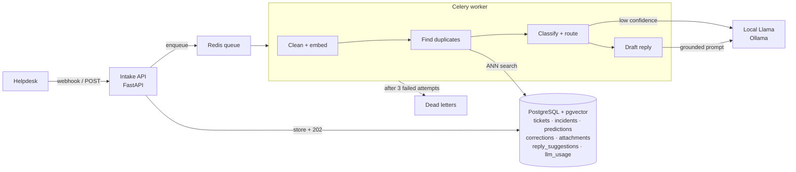

# Support Ticket Triage Engine

A real-time ticket triage service that deduplicates, classifies, routes and drafts replies for support
tickets using embeddings, vector search and LLMs, with a human-in-the-loop fallback for uncertain cases.

**Stack:** FastAPI · PostgreSQL + pgvector (HNSW) · Redis + Celery · sentence-transformers · scikit-learn ·
Llama 3.2 via Ollama (local; Groq optional) · Prometheus metrics · Docker Compose · pytest · Locust

## Results

Measured on the held-out test split of a labeled TaskFlow dataset (standalone tickets, duplicate groups
and incident bursts, split by group), generated locally with `llama3.2:3b`. Thresholds were chosen on
train data only. Embeddings: `all-MiniLM-L6-v2`.

**Label quality:** a random sample was hand-audited: 98% of labels were correct; the rest were relabeled
(`data/review_corrections.json`).

| Capability | Metric | Target | Measured |
|---|---|---|---|
| Duplicate detection | pairwise precision / recall, threshold 0.62 | ≥ 0.90 / ≥ 0.75 | **0.911 / 0.976** (F1 0.943) |
| Classification | accuracy · macro-F1 | ≥ 0.85 (category) | category **0.951 · 0.905**; team **0.976 · 0.906**; priority 0.463 · 0.417 |
| Routing (classifier only) | auto-routed · accuracy of auto-routed, threshold 0.4 | ≥ 70% at ≥ 95% | **92.7% at 100%** |
| Routing (+ Llama fallback) | same, uncertain tickets sent to `llama3.2:3b` | | 95.1% at 100% |
| Reply suggestions | usable share of test tickets (rated drafts + declines judged by subtopic) | ≥ 60% | **70%**: every written draft rated usable; drafts written for 67% of tickets; most declines missed a matching source |
| Intake latency | `POST /tickets` p95, at 15 tickets/s sustained | < 100 ms | 170 ms (p50 110, p99 280); 0 errors |
| Processing latency | receipt → triaged, p95, at 15 / 18 tickets/s | < 3 s | **0.61 s** / **1.16 s** |
| Throughput | max sustained (queue stays flat), none lost | 50 /s | **~18 tickets/s**; no tickets lost in the sustained runs |
| Cost | LLM cost | report | ~$0.00002 per draft, ~$0.00005 per fallback classification (Groq list-price equivalent; local Ollama is free) |

**Read these with care:**
- **Small test set,** so each number moves a lot with a handful of tickets, and "100%" routing accuracy
  has a wide confidence interval. Treat these as a first measurement, not a benchmark.
- **Dedup train/test gap.** On train, no threshold reached 0.90 precision (best ≈ 0.79), so 0.62 was picked
  by best F1; train precision there is 0.557. The 3B generator wrote same-subtopic standalone tickets very
  alike, which creates false duplicate pairs; the test split happens to contain fewer, so the test
  precision may not generalize.
- **Generated text is easier than real tickets.** Some duplicates are near-verbatim rewrites.
- **The Llama-fallback row is biased.** The same model family wrote the tickets and classified them.
- **Priority is hard from text alone** and is not used for routing (category + team are).
- **Reply drafts mostly copy their source reply,** including details that belong to the past ticket (the
  customer's name, "we've restarted the job"), so "usable" means usable after an agent edits those. The
  knowledge base was itself written by the 3B model and has odd answers that drafts inherit. A
  "no suggestion" counts as correct only if no retrieved source shares the ticket's subtopic; most had
  one (the model declined or didn't cite), so they count as missed: safe, but no help to the agent.
- **Performance** is measured with the fake LLM and the load generator on the same host. The 50/s
  target isn't met: each ticket needs ~165 ms of worker CPU
  (embed 72 ms, dedup 65 ms, classify 27 ms). Full method and runs: `reports/load_test_summary.md`.

Charts: `reports/dedup_pr_curve.png` (precision vs recall across thresholds) and `reports/routing_tradeoff.png`.

## Architecture



The intake API only stores the ticket and queues a job, so it answers in milliseconds; all AI work
happens in the worker. Each worker step commits separately and is skipped if already done, so a retry
resumes where it failed.

| Step | What happens |
|---|---|
| Clean | Strip HTML, quoted reply chains (Gmail/Outlook), signatures, `Re:`/`Fwd:` prefixes |
| Embed | `all-MiniLM-L6-v2` (384-d, CPU), stored in `tickets.embedding` |
| Dedup | Nearest open-incident ticket within ±72 h via HNSW; join its incident if cosine ≥ threshold, else start one |
| Classify | Logistic regression per field (category, priority, team) on the embedding → probability as confidence |
| Route | Category and team confident → auto. Otherwise ask the LLM; if it agrees with the classifier → auto, else → review queue |
| Draft | Top-5 resolved tickets; none ≥ 0.5 similarity → "no confident suggestion" (no LLM call). Else LLM drafts using only those, citing `[S1]`…; uncited drafts are discarded |

## Running it

```bash
cp .env.example .env
docker compose up -d --build         # db, redis, migrate, api, worker
open http://localhost:8000/docs      # Swagger UI
docker compose run --rm api pytest   # full test suite (needs db + redis)
```

### LLM: local Llama via Ollama (default)

```bash
# install Ollama from https://ollama.com (runs on the host, not in Docker), then:
ollama pull llama3.2:3b
python -m scripts.check_llm        # one classification + one draft, with timings
```

`llama3.2:3b` needs about 2 GB RAM and runs on CPU. With 16 GB+ RAM or a GPU, set
`OLLAMA_MODEL=llama3.1:8b` for better accuracy. Containers reach the host's Ollama through
`host.docker.internal` (set in `docker-compose.yml`); scripts on the host use `localhost`.

On CPU, an LLM call takes seconds, so it is used only when the classifier is unsure and for drafts.
Drafts run as a separate task, so they never delay triage. Load tests use `LLM_PROVIDER=fake`, so
they measure this system rather than LLM speed. Other providers: `groq` (hosted, needs
`GROQ_API_KEY`) and `none`.

### Full workflow

```bash
pip install -r requirements-dev.txt          # local venv for scripts (or prefix with docker compose run --rm api)

# 1. Dataset (Gemini writes tickets; labels are chosen first)
python -m scripts.generate_dataset           # data/tickets.jsonl, groups.jsonl, resolved.jsonl
python -m scripts.sample_for_review          # read a sample by hand, fix or drop bad ones

# 2. Models + thresholds (all tuned on train, reported on test)
python -m scripts.eval_dedup                 # -> DEDUP_THRESHOLD
python -m scripts.train_classifier           # -> models/classifier.joblib
python -m scripts.eval_classifier            # -> ROUTE_THRESHOLD   (add --llm 200 to measure the fallback)
docker compose restart worker

# 3. Knowledge base for replies, then replay the test split through the live service
python -m scripts.load_resolved
python -m scripts.replay --split test
python -m scripts.processing_report --minutes 30
python -m scripts.eval_replies generate      # rate reports/reply_review.md by hand, then:
python -m scripts.eval_replies score

# 4. Load test: fake LLM, no auto-reload, 2 API processes (PowerShell; values apply to this command only)
$env:LLM_PROVIDER='fake'; $env:UVICORN_FLAGS='--workers 2'; docker compose up -d --force-recreate api worker worker-drafts
locust -f loadtest/locustfile.py --host http://localhost:8000 --headless -u 15 -r 5 -t 2m --csv reports/load_15
python -m scripts.processing_report --minutes 3 --key-prefix load-
Remove-Item Env:LLM_PROVIDER, Env:UVICORN_FLAGS; docker compose up -d --force-recreate api worker worker-drafts
```

## API

| Method | Endpoint | Purpose |
|---|---|---|
| POST | `/tickets` | Submit (multipart; `Idempotency-Key` header required; optional attachments) → 202 + id |
| POST | `/webhooks/tickets` | Same for helpdesks; HMAC signature over `timestamp.body` |
| GET | `/tickets/{id}` | Ticket with status, labels, routing, predictions, incident |
| GET | `/tickets/{id}/similar` | Top similar resolved tickets with similarity |
| GET | `/tickets/{id}/suggested-reply` | Draft with cited sources (`pending` / `ready` / `no_suggestion`) |
| POST | `/tickets/{id}/suggested-reply/approve` | Agent approves a draft (never sent automatically) |
| POST | `/tickets/{id}/corrections` | Human fixes category / priority / team (empty body = approve) |
| GET | `/review-queue` | Low-confidence tickets awaiting a human |
| GET | `/incidents?status=open` | Incidents by size, then priority |
| GET | `/incidents/{id}` | Incident with its tickets |
| POST | `/incidents/{id}/merge` | Merge another incident into this one |
| POST | `/incidents/{id}/split` | Move tickets out into a new incident |
| GET | `/health`, `/metrics`, `/dead-letters` | Liveness, Prometheus metrics, failed jobs |

## Design decisions

1. **Choosing the similarity threshold.** `scripts/eval_dedup.py` replays the service's exact grouping rule
   (`group_online`) over each split in time order and sweeps the threshold. The pick is the highest recall
   with precision ≥ 0.90 on train, reported on test. Precision matters more: a wrong merge hides a
   separate problem inside someone else's incident.
2. **Race conditions in incident grouping.** "Search, then join or create" is a check-then-act race; two
   simultaneous duplicates would each start an incident. Assignment is serialized with a global
   transaction-scoped advisory lock (`pg_advisory_xact_lock`); a per-incident lock can't work because the
   incident isn't known until after the search. Merge/split take the same lock.
   The first version held the lock across the ANN search too. The load test showed that capped throughput
   at ~18 tickets/s, and the search time grows with the table. Now it's optimistic:
   read a high-water mark under the lock (assignments are numbered by a sequence, and holders commit
   before releasing), search without the lock, then under the lock check only tickets assigned during
   the search before joining or creating. Lock hold time dropped to ~27 ms and no longer grows with the
   table. `tests/test_pipeline.py::test_concurrent_duplicates_create_exactly_one_incident` covers it.
3. **Idempotent webhooks.** Unique `idempotency_key` + `INSERT … ON CONFLICT DO NOTHING`; the unique index is
   the arbiter, so concurrent retries can't create two tickets. A replay of a ticket still in `received` is
   re-enqueued, which heals a crash between commit and enqueue. Webhook signatures include a timestamp to
   block replays.
4. **Retries and dead letters.** Celery `autoretry_for` with exponential backoff + jitter, 3 attempts, then
   the job is pushed to a Redis dead-letter list and the ticket marked `failed` with the error. LLM 429s go
   through the same path. `acks_late` means a crashed worker's job is redelivered; a per-ticket Redis lock
   stops duplicate deliveries from processing concurrently. A load test once left a ticket in `received`
   (stored, but the enqueue was lost when the client connection reset), so a sweeper (Celery beat, every
   30 s) re-enqueues tickets stuck in `received` > 5 min or `processing` > 10 min. Reply drafts run on
   their own queue and worker, so slow LLM calls never hold up triage.
5. **Knowing when not to trust the model.** Calibrated classifier probabilities with a tuned threshold;
   LLM self-reported confidence is not trusted. Agreement between two different models is used instead.
   Replies: a similarity floor before calling the LLM, an explicit `NO_SUGGESTION` answer, and drafts that
   cite nothing are discarded.
6. **Keeping vector search fast.** HNSW (`m=16, ef_construction=64`) with cosine ops; dedup filters by time
   window and open incidents with pgvector 0.8 iterative index scans so filtering doesn't starve results;
   a partial HNSW index over resolved tickets only for reply retrieval.
7. **Cost control.** Embeddings and the classifier run locally on every ticket; the LLM runs only for
   uncertain routing fields and for drafts with relevant sources. Every call is logged in `llm_usage` with
   tokens and equivalent cost; `scripts/processing_report.py` reports cost per ticket.
8. **Learning from corrections.** Every prediction and correction is stored. `train_classifier
   --with-reviewed` retrains with human-reviewed tickets' final labels.

**Why logistic regression on embeddings rather than an LLM for every ticket?** It's microseconds per
ticket, free, gives probabilities that can be thresholded, and retrains in seconds from corrections. The
LLM is reserved for the minority of cases where that model is unsure.

**Two clocks.** `created_at` is when the customer wrote the ticket (settable on replay, used for dedup
windows); `received_at` is server time, used for processing latency.

## Project layout

```
app/
  api/            tickets, webhooks, incidents, health + metrics
  services/       cleaning, embeddings, dedup, classifier, routing, llm, replies, incidents, intake, pipeline
  worker/         Celery app + tasks (retries, dead letters)
  taxonomy.py     TaskFlow categories, teams, priorities, subtopics
scripts/          dataset generation, replay, training, evaluations, reports
loadtest/         Locust file
tests/            unit tests (no services) + DB/API tests (run in Docker)
```

## Scope

Not included by design: helpdesk UI (Swagger is the UI), real helpdesk integrations (generic signed
webhook), image/OCR analysis (attachments stored, not read), training models from scratch, multi-region.
